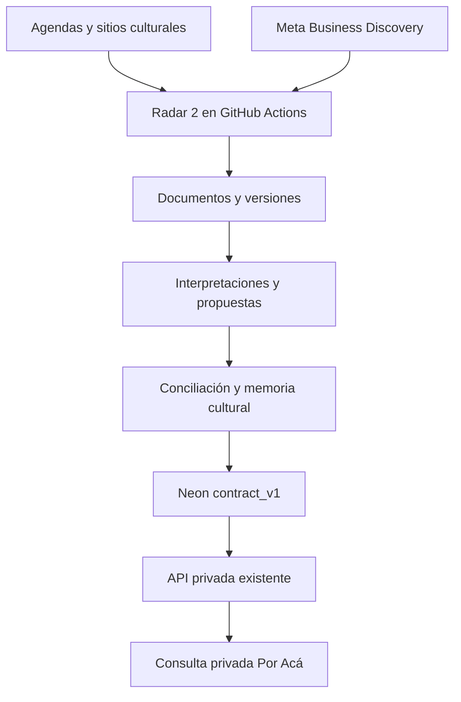

# Radar 2: contrato operativo v1 — 7 noviembre 2026 UTC

## Flujo operativo

Un solo workflow: FULL 05:27 ART, incrementales 13:27 y 20:27 ART. GitHub puede demorar los cron; la configuración no prueba tres ejecuciones naturales. Las ejecuciones manuales full/incremental ahora invocan Radar 2 y no el recolector legado. `verify_only` conserva la verificación anterior sin ingesta.

FULL consulta las agendas, hasta 10 cuentas rotativas más 4 controles y 12 enlaces. Incremental consulta agenda del día, hasta 10 cuentas rotativas sin repetir controles y 6 enlaces. El corpus oficial se reinterpreta en FULL; incremental procesa versiones nuevas y documentos pendientes. No se consulta Instagram HTML ni índices públicos para adquirir publicaciones. Una interrupción conserva la rotación reclamada durante 2 horas; el siguiente intento recupera pendientes. La adquisición incompleta antes del commit se repite acotadamente; no existe todavía checkpoint durable por cada petición HTTP.

## Diccionario y acceso

`radar2.contract_v1(id text, resource text, data jsonb)` es la representación homogénea entre fuentes. Todos los IDs tienen prefijo de tipo. La API mantiene la ruta existente: `/api/radar2?resource=events&limit=20&after=<id>`. Recursos: `events`, `occurrences`, `places`, `actors`, `relationships`, `sources`, `documents`, `proposals`, `accounts`, `runs`. Campos desconocidos son null. Paginación por ID ascendente; máximo 100, límite por defecto 20. Las inserciones concurrentes requieren reiniciar el recorrido para capturar IDs anteriores al cursor; no es una instantánea transaccional. `from`/`category` siguen perteneciendo a la consulta anterior de descubrimientos, no al contrato genérico.

- Documentos: original, URL, publicación, adquisición, última observación, hash/versión.
- Propuestas: título, documento, fecha/hora, lugar/categoría, estado y evidencia.
- Eventos: título, categoría, ocurrencias y documentos corroborantes. Conservador: por ahora un evento por ocurrencia representativa; vincular funciones a una obra común sigue pendiente de conciliación editorial.
- Ocurrencias: evento, fecha, hora, zona Argentina, precisión, estado, evidencia. Medianoche ambigua conserva hora null y motivo explícito.
- Lugares/actores: identidad normalizada dentro de rol, evidencia y estado de revisión. Son nombres observados, **no identidades verificadas automáticamente**.
- Relaciones: sujeto, predicado, objeto, propuesta, URL y extracto. El contrato normaliza los prefijos de nodos y resuelve sujetos contra la propuesta representativa; los sujetos sin representación quedan null y pending_event_identity_review, con original_subject preservado. No son identidades canónicas aprobadas.
- Fuentes/cuentas: productividad, última observación, selección, intentos y restricciones. La lista de fuentes agrupada por nombre se complementa con el padrón por cuenta.
- Corridas: modo, readback, consultas, adquisición, extracción, memoria y salud de credencial.

Estados: documento observado → candidato → nombre identificado pendiente de revisión → evento estructurado no aprobado. `fuente_original` expresa procedencia, no corroboración independiente ni aprobación. Esta intervención no crea estados falsos de corroboración o publicación: `publication_approved=false`.

La app actual sigue usando sus endpoints existentes. El contrato nuevo es consumible en esta misma API privada; no certifica una integración completa del grafo en toda la interfaz. No se realizó QA estética/UX.

## Conservación y reversión

Migración aditiva reproducible: `unified.sql`, ensayada sobre clon `br-calm-queen-b46np7a8` de `br-mute-recipe-b4odj2bl`, LSN `0/113503D0`. Copia original: 492 documentos, 491 propuestas. No se borraron originales. Tablas de versiones conservan payloads y versiones de interpretaciones mediante triggers; el rol escritor no recibe permisos para borrar versiones ni para modificar canon. La versión documental identifica el contenido por hash, las observaciones repetidas se registran por corrida, no duplican el texto.

Rollback de código: restaurar el SHA previo `7da10b107221233e379818ca6698d0d37197e8a2` mediante commit de reversión, manteniendo las tablas/vistas aditivas y la evidencia nueva. Ante un error de interpretación, reconstruir desde `document_versions`; no revertir la rama de producción completa ni perder observaciones posteriores. El clon permite contrastar el inventario previo. No ejecutar reset destructivo.

## Rotación, descubrimiento y autodepuración

La rotación persiste en un ledger Neon con CAS, versión y lease; prioriza cobertura de cuentas nunca intentadas y prioridad cultural. Meta registra elegibilidad real, publicaciones y errores; una inaccesibilidad no prueba inexistencia. Controles diarios separados. Las fuentes improductivas reducen frecuencia y las rechazadas se archivan sin eliminar evidencia.

La frontera de enlaces y la memoria existentes se conservan. El descubrimiento de nuevos circuitos, la incorporación autónoma de cuentas a partir de captions y una prioridad adaptativa por rendimiento no están completos en este corte. No se presentan categorías temáticas como circuitos corroborados. La identidad de personas/lugares y las fusiones ambiguas requieren revisión.

## Meta y recuperación

Credenciales consumidas desde GitHub Secrets; ningún secreto en Neon/código/logs. Se pide ID externo/tipo de medio sin almacenar binarios. La salud comprueba `/me/permissions` y mantiene el resultado oficial de Business Discovery. La fecha de caducidad configurable no es introspección del token: `expiry_introspected=false`; la caducidad del acceso a datos sigue desconocida. No se declara renovación automática. No hay App Secret ni mecanismo autorizado de escritura de secretos disponible en este conector.

La colección oficial de Meta distingue el token de usuario del token de página enlazada: https://www.postman.com/meta/instagram/documentation/6yqw8pt/instagram-api . La documentación de tokens largos https://developers.facebook.com/docs/facebook-login/guides/access-tokens/get-long-lived/ devolvió 429 al verificarla. Falta probar una credencial de página compatible y su almacenamiento/consumo antes de prometer continuidad desatendida. No se aplica el refresh de Instagram Login a este flujo Facebook Login.

Errores Meta de autenticación/cuota cortan el lote, sin intentos HTML. Fuentes fallidas no abortan las demás. Neon reintenta errores transitorios hasta 3 veces, nunca errores 403/permisos. CAS y UPSERT mantienen IDs; el workflow serializa corridas. Si Neon está caído no se declara persistencia ni éxito: la corrida queda fallida y el próximo intento vuelve a adquirir lo no persistido.

## Aceptación y límites

`evidence/caption-30-review-20261107.json` contiene 30 URLs reales anotadas por el agente: no es muestra independiente ni holdout. Precisión/recuperación de fechas por ocurrencia no equivalen a precisión de títulos, roles o todos los campos. Faltan actos secundarios de medianoche y muestra de festival etiquetada independientemente. Las pruebas unitarias simulan fallos Meta/Neon y verifican límites; no acreditan varios días de continuidad natural.

**NO GO para certificación integral 10/10** mientras existan esos defectos internos, circuitos/identidad incompletos o contrato no validado completamente. El funcionamiento técnico y los hallazgos reales se reportan por separado. No se cierra el maestro ni se archivan obligaciones incumplidas como completadas.
